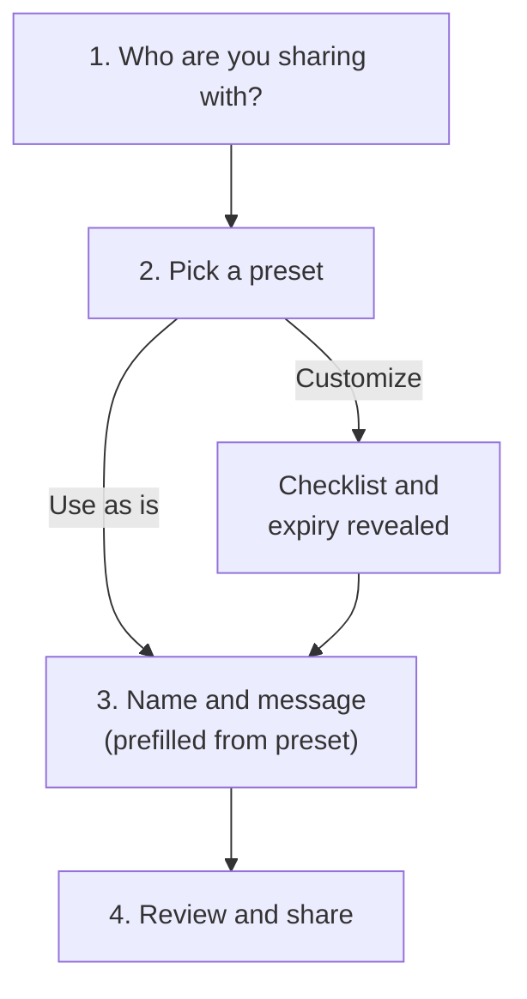

# BetterSharing: Nextcloud sharing app plan

Status: design finished (John, 4 October 2026); draft for adversarial review. No code written yet.

App name BetterSharing, app ID `bettersharing` (John, 2026-10-03). No app in the Nextcloud app store index uses that ID (851 apps checked, 3 October 2026). App IDs cannot be changed after release.

## Goal

Replace the stock Nextcloud sharing sidebar with a sharing flow a new user understands without training. Nothing about it is specific to law firms (John, 2026-10-03).

Requirements from John (2026-10-03):

1. **One list of people.** The user types names or email addresses. Whether a person is inside or outside the firm is the system's problem, not the user's.
2. **Permissions as a checklist, plus presets.** Presets ("CSM Packet", "Uploads only") are owned by the firm, not by individual users, and include everything: permissions, expiry, and message.
   - Outside recipients always get a password; no preset or customization can turn it off. The password reaches them by a separate email, the same mechanism the stock sharing UI uses.
   - Expiry applies to outside recipients only. A preset sets the default (a number of days, or none); the person sharing can override it with any specific date. Shares to firm staff do not expire unless edited.
3. **Share name**, defaulting to the file or folder name.
4. **Message for people with access**, usually instructions for clients.
5. **Progressive disclosure.** A new share reveals options only as they become relevant. The exception is an existing share: its editor shows every setting at once, because everything is already chosen.

## Verified facts (Nextcloud 34.0.4 on N5, read 3 October 2026)

| Fact | Source |
| --- | --- |
| Nextcloud 34.0.4, snap install, tracking `latest/stable` | `nextcloud.occ status`, `snap list nextcloud` |
| Custom apps install to `/var/snap/nextcloud/current/nextcloud/extra-apps` (writable app path) | `config:system:get apps_paths` |
| `files_sharing` 1.26.0, `sharebymail` 1.24.0, `spreed` 24.0.5, `admin_audit` enabled | `app:list` |
| Frontend stack: Vue 3.5, `@nextcloud/vue` 9.9, `@nextcloud/files` 4 | server `package.json` |
| **No outbound mail configured** (`mail_smtpmode`, `mail_smtphost`, `mail_from_address` unset) | `config:system:get` |
| Link passwords enforced (`shareapi_enforce_links_password=1`); no default expiry; public upload allowed | `config:app:get core` |
| Share passwords are emailed separately today: `sharebymail sendpasswordmail` is unset, and unset or `yes` means enabled (any other value, including `1`, disables it) | `config:app:get ... --default-value=__unset__` (4 Oct 2026); `apps/sharebymail/lib/Settings/SettingsManager.php` (`sendPasswordByMail()` returns `=== 'yes'`, default `'yes'`) |
| Shares to people at the firm always get read permission added, so upload-only is impossible for them | `ShareAPIController.php:662-663` |
| Link and email shares need READ or CREATE; UPDATE and DELETE require READ | `ShareAPIController.php:1025-1034` |
| Single-file shares silently drop CREATE and DELETE | `ShareAPIController.php:666-669` |
| The share label is the public share page's header and browser title | `DefaultPublicShareTemplateProvider.php:144-146` |
| The share email subject and heading use the file name, not the label | `ShareByMailProvider.php:326-345` |
| The note is included in the share email, shown on the public share page, and shown to firm users | `ShareByMailProvider.php:326`, `DefaultPublicShareTemplateProvider.php:100`, `MountProvider.php:210` |
| Creating a share for someone who already has one returns the existing share and fires the creation event again | `lib/private/Share20/Manager.php:649-667` |
| Firm recipients are notified as soon as a share is created, whether or not mail is turned off | `files_sharing/lib/Notification/Listener.php:30-49` |
| If a share email fails to send, `sharebymail` deletes the share | `ShareByMailProvider.php:252-308` (`removeShareFromTable`) |
| Inherited download restrictions are enforced by the stock controller (`checkInheritedAttributes`), not by `IManager` | `ShareAPIController.php:813, 1378, 2069`; absent from `Share20/Manager.php` |
| Link-password enforcement also covers email shares; when enforced and no password is given, `sharebymail` generates one | `ShareByMailProvider.php:98-102, 126` |
| `files_downloadlimit` (enabled) limits downloads for link and email shares of single files only, not folders | `files_downloadlimit/lib/Controller/ApiController.php:134-140` |
| "No download" is stored as share attribute `permissions.download=false` plus `hideDownload`; a parent share that forbids download forces both | `ShareAPIController.php:2124-2139` |
| `files_sharing` exposes sidebar extension points (`registerSidebarAction`, `ShareTabSections.registerSection`) | `dist/files_sharing-files_sharing_tab.js` |
| The instance has one group (`admin`); firm groups do not exist yet | `group:list` |

Still unverified (phase 0 resolves each before code depends on it):

- Resolved in phase 0 (2026-10-05): changing an email share's password through `IManager` emails the new password (tested). Mail delivery failures are not visible to callers: Nextcloud's mailer logs a failed send and returns normally, so neither BetterSharing nor the stock sharing screen can tell that a link or password email did not go out. Failures BetterSharing can see (Nextcloud refusing a share) are reported to the sharer.
- The exact public API for adding a file action and sidebar tabs in `@nextcloud/files` 4, and whether the stock Sharing and Versions tabs can be hidden without CSS overrides. If they cannot, the sidebar shows two Sharing tabs and two places for versions, which defeats the purpose; that outcome needs John's decision before phase 2.
- Where access history comes from: the `activity` app's sharing events (shared, unshared, expired, password sent) for this item, and whether they cover shares made through the stock UI and through `IManager`. If they do not, the app records its own events for the bundles it manages, and the History tab says that shares made outside BetterSharing may be missing.
- Whether `admin_audit` logs shares created through `OCP\Share\IManager` from an app (expected yes, since it hooks share events).

## Prerequisites (blocking)

1. **Outbound mail.** Without working mail, email shares fail (`sharebymail` deletes a share whose email cannot be sent). Configure Nextcloud mail with the sending address `cloud@outlaw.app` (John, 2026-10-04) before the outside-the-firm path ships; SMTP details still needed. Leave `sharebymail sendpasswordmail` unset (enabled). BetterSharing's readiness check uses the same rule as `SettingsManager::sendPasswordByMail()` and disables the outside-the-firm path, with a plain message, while mail or password delivery is not ready.
2. **Firm groups.** Presets and name lookup are scoped per firm, and N5 will host more than one firm (`NEXTCLOUD-ACCOUNTS.md`). The group naming scheme listed as open there must be decided first, because group IDs cannot be renamed. Every group used for sharing contains only one firm's accounts.
3. **Core firm isolation.** Turn on `shareapi_only_share_with_group_members` and exclude `admin` and any group that spans firms from it, so Nextcloud's own sharing screen, sharee search and share API cannot find or share with another firm's users either. BetterSharing's firm scoping is a second layer, not the only one.
4. **Pin the Nextcloud major version.** The snap tracks `latest/stable`, so Nextcloud 35 installs automatically on release, and the upgrade disables any app whose `info.xml` does not allow 35. Switch to the `34/stable` channel and move channels deliberately after the app is tested on the new major.
5. **Test instance.** A disposable Nextcloud 34 in Docker on the Mac, with a local mail sink (Mailpit). Never test against N5.

## User experience

### Sidebar tabs (John, 2026-10-03)

The file sidebar has four tabs:

| Tab | Contents |
| --- | --- |
| Sharing | Current shares of this item and the Share action (new-share flow, editor, who has access) |
| Presets | The firm's presets, first-class: each with its summary, message and "New Share". Firm administrators also create, edit and delete presets here. Others see them read-only. |
| Activity | Nextcloud's existing activity stream for the item |
| History | Access history from Nextcloud's activity events (shares created and removed, labeled as possibly incomplete; activity keeps entries 365 days by default) and file versions (Nextcloud's versions; for a folder, a note to select a file). The instance audit log is never shown to firm users. |

Sharing and History replace the stock Sharing and Versions tabs, subject to the phase 0 check that the stock tabs can be hidden.

### New share: guided steps (John, 2026-10-03)

The Share action (file row menu, file toolbar, or the Sharing tab) opens a dialog that asks one question per step. A stepper across the top shows the four steps as numbered circles joined by a line: finished steps show a check mark and can be selected to go back, the current step has a highlighted ring and a bold label, and steps not reached are gray. At phone width only the current step's label shows. Back and Next move between steps; the last step's button is Share. After sharing, the dialog confirms and closes, and the new share appears in the Sharing tab, which also holds the editor for existing shares.

1. **People.** One field. Each entry gets a plain label once resolved: "At your firm" or "Gets a private link by email". An unrecognized name gets "No one at your firm by that name. Enter their email address."
2. **Access.** The firm's presets (pinned first, then search and sort over all presets; see Firm presets), each with a one-line plain summary ("Can view, download, and upload. Outside links end after 14 days."). Choosing one is enough to continue. "Customize" reveals the permission checklist; expiry appears only if the list includes someone outside the firm. There is no password control: outside recipients always get one. Changing any setting turns the preset label into "Custom".
3. **Name and message.** Name defaults to the file or folder name. The message is prefilled from the preset's template and is editable.
4. **Review.** Nothing is shared until the user selects Share. One line per recipient with how they will receive it. Someone who already has access to the item is shown as "Already has access" with their current settings and a link to edit that share; BetterSharing never creates a second share for them or changes theirs from this dialog. Differences from the preset are stated here, never silently applied: "Dana Whitfield also gets view and download (people at your firm always can view and download)."

Reveal rules:

- Upload-only and delete options do not appear for single files (Nextcloud drops them).
- Expiry appears only when someone outside the firm is on the list. The review step states "Password sent by separate email" for each outside recipient.
- Errors appear on the step that caused them; Next stays on that step until it is fixed. Going back keeps every answer.
- Closing the dialog before Share discards the draft; nothing has been created.

After Share, each recipient is handled on its own (John, 2026-10-04: partial success is acceptable as long as the sharer is told). The dialog's last screen lists every recipient with its result: shared, already had access, or not shared with the reason and a Retry action. Successful shares stay in place when another recipient fails. Any failure, including one that happens after the dialog closes (for example a password email that could not be sent), also sends the sharer a Nextcloud notification that links to the share.

### Existing share: full editor

Opening an existing share shows one panel with everything: people, checklist, expiry, name, message, a "Send new password" action per outside recipient, and a "Stop sharing" control per person and for the whole share. Saving applies the change recipient by recipient and reports each result the same way as a new share. If a share changed or was removed elsewhere since the panel opened, that recipient is reported as changed and the panel refreshes instead of overwriting. "Send new password" sets a new password, which Nextcloud emails; BetterSharing never stores passwords. A share whose source folder forbids download is shown read-only (see Download restrictions).

### Who has access

Replaces "Others with access". One list of every person and link with access to the item, including access inherited from a parent folder (labeled with the folder it comes from and a link to it). Shares created with the stock UI appear here as standalone entries and open in the same editor.

### Firm presets

Managed in the Presets tab by firm administrators (Nextcloud subadmins of the firm group, plus instance admins), checked server-side. Create, edit, pin, and delete presets; deleting asks for confirmation and does not affect existing shares. A preset holds a name, permissions, a default expiry in days for outside links (or none), and a message template; outside recipients always get a password, so there is no password setting. Seed each firm with: "View and download", "Uploads only", "Full edit". Firms add their own ("CSM Packet").

Firms may build up many presets, so both places they appear scale (John, 2026-10-03):

- **Picking a preset while sharing:** the firm's pinned presets first (up to 4, chosen by firm administrators), then "All presets" with search (name and message) and a sort control (most used, recently used, name, recently changed). Without a search, the five top results show, with "Show all".
- **Presets tab:** a table with columns Preset, Uses, Last used and Changed. Selecting a column heading sorts by it; selecting it again reverses the order. Pinned presets are grouped first. Search filters by name and message. Selecting a row shows its message, "New Share" and "Edit Share" (both shown as links).

The pin limit and the usage counters are enforced inside the preset's database transaction, so two administrators pinning at once cannot exceed 4, and one share operation counts once however many recipients it has.

Changing a preset does not change shares already created from it. The share keeps a copy of the settings it was created with. Retroactive changes would silently widen or narrow access on live shares.

## Mapping to Nextcloud

Every share the app makes is an ordinary Nextcloud share. Disabling the app leaves all access working and visible in the stock UI.

| BetterSharing concept | Nextcloud share |
| --- | --- |
| Person at your firm | User share (type 0) |
| Firm group | Group share (type 1) |
| Email address | Email share (type 4), one share per address |
| Name | `label` (public share page title; owner-facing for firm shares) |
| Message | `note` |
| Password | Generated by `sharebymail` (password enforcement is on) and emailed separately; never stored or seen by BetterSharing |
| Expiry | `expireDate`, email shares only |

| Checklist item | Permission | Constraint |
| --- | --- | --- |
| View and download | READ (1), download always allowed (`permissions.download` true, `hideDownload` false) | Forced on for firm recipients |
| Upload files and create folders | CREATE (4) | Folders only. Upload-only (CREATE without READ) for email recipients only |
| Edit existing files | UPDATE (2) | Requires View and download |
| Delete files and folders | DELETE (8) | Folders only. Requires View and download |

Decisions (John, 2026-10-03):

- **No resharing.** BetterSharing never grants SHARE (16), and the create and update endpoints strip it if a request includes it. A recipient who has resharing rights through some other share still has them; BetterSharing only guarantees it grants none.
- **Download is part of View.** There is no separate download switch: Nextcloud can hide a download button, but anyone who can open a file can copy it, so view-without-download would promise protection it cannot give. The checklist description says this.

Nextcloud cannot separate creating folders from uploading files, or deleting folders from deleting files, so the checklist does not offer those splits.

**Download restrictions.** View includes download, so BetterSharing cannot honor a source that forbids download. Before creating or editing, the server applies BetterSharing's own conservative rule, built only on public `IManager`/`IShare` data: it looks at every incoming share that reaches the item (on the item or any ancestor folder, including ownerless mounts) and refuses if any has the download attribute set to false or hide-download set. This is stricter than Nextcloud's internal controller check, never looser. If it refuses, BetterSharing refuses with a plain message ("This folder was shared with you without download rights, so it can't be shared through BetterSharing.") and never clears an existing restriction.

## Firm scoping and recipient resolution

- **Firm membership.** App settings list which Nextcloud groups are firm groups. A user's firm is the one firm group they belong to. Zero or more than one: BetterSharing refuses to share or show presets, with a clear message, and no share is created (fails closed).
- **Name lookup** searches only members of the sharer's firm group and the firm's own groups. Users of other firms on the same instance never appear. When Nextcloud restricts sharing to the sharer's own groups, only groups the sharer belongs to are offered.
- **Email entries.** An address that is the username of an account in the sharer's firm resolves to that account. Any other address becomes an ordinary email share. Firms are fully separate (John, 2026-10-04): anyone outside the sharer's firm is treated as outside the system, so the app never looks up accounts in other firms and gives no sign that an address has an account elsewhere on the server.
- **The server enforces all of this.** The create endpoint re-resolves every recipient; it does not trust what the browser sent.
- Core isolation (prerequisite 3) covers the stock sharing screen and APIs.

## Data model (app tables)

- `bettersharing_presets`: id, firm group ID, name (unique per firm), permission bitmask (READ, CREATE, UPDATE, DELETE only), outside-recipient expiry days (nullable means no expiry), no password field (always required for outside recipients), message template, pinned flag (at most 4 per firm, enforced server-side), use count and last-used time (updated when a bundle is created from the preset), updated by, updated at.
- `bettersharing_bundles`: id, owner, firm group ID, file ID, name, message, preset ID and preset name at creation (provenance only; current settings always come from the Nextcloud shares), status (in progress, complete), idempotency key, request fingerprint (hash of the canonical request), created at. The idempotency key is unique per owner, firm and file; reusing it with a different fingerprint is refused. One bundle is what the user thinks of as "a share".
- `bettersharing_recipients`: one row per recipient of a bundle, written in the same transaction as the bundle and before any share is created: bundle ID, recipient, kind (firm user, firm group, email), requested settings (permissions, expiry), status (pending, claimed, shared, already had access, failed, removed), `share_id` (set only on the row that created the share; unique index, so one Nextcloud share has exactly one owning row; cleared when removed), `existing_share_id` (access that existed before, or a share another row already owns; never changed by BetterSharing), result message, claimed at, updated at. A row that loses the uniqueness race is recorded as already had access.

Shares changed or removed through the stock UI are reconciled on read: missing shares are dropped, and permissions, expiry, label and note are always read from Nextcloud. Nextcloud's share table is the source of truth.

## Backend

OCS controllers on the app's own routes:

- `GET /presets`, `POST/PUT/DELETE /presets/{id}`: write calls require firm subadmin or instance admin, checked server-side.
- `GET /recipients?search=`: firm-scoped lookup.
- `POST /bundles`: create.
- `GET /bundles?fileId=`, `PUT /bundles/{id}`, `DELETE /bundles/{id}`, `DELETE /bundles/{id}/recipients/{shareId}`.
- `GET /access?fileId=`: the "Who has access" list.

Creating a bundle (validate, record intent, then act per recipient):

1. Validate: resolve and scope every recipient to the sharer's firm, check the permission set against the item type, check the download policy (Download restrictions), and look up existing shares for each recipient on the item. Any validation failure returns an error and creates nothing.
2. Record intent: in one transaction, insert the bundle row (status in progress, idempotency key, request fingerprint) and one recipient row per recipient (pending, or already had access). A repeated submission with the same key and fingerprint returns that bundle's recorded results; the same key with a different fingerprint is refused.
3. Act per recipient: for each pending row, mark it claimed (with the time) before calling `OCP\Share\IManager::createShare` with Nextcloud's normal notifications and email (mail on), then record the share ID and status shared. A failure (including `sharebymail` deleting a share whose email failed) sets the row to failed with its reason; successful shares are never undone.
4. Finish: mark the bundle complete, increment the preset's usage once, return per-recipient results, and send the sharer a Nextcloud notification for any failed rows.

Recovery: a claimed row with no share ID (the process stopped between the call and the update) is resolved by looking up the recipient's shares on the item. A share created by the bundle owner after the row's claim time is adopted as this row's share; otherwise the row is set to failed and reported. Retry acts only on failed rows. Opening an in-progress bundle, or resubmitting with the same key, runs recovery first. Before any pending or failed row is shared (first attempt or Retry), its recipient is checked again: a user still in the firm, a group still single-firm and allowed, an address that still does not belong to someone at the firm. A recipient that no longer qualifies is reported as failed and not shared. Completion and the preset's usage count are written in one transaction.

Passwords: Nextcloud requires the password when an email share is created, so BetterSharing generates it at that moment through Nextcloud's password policy (`GenerateSecurePasswordEvent`, sharing context) and hands it to Nextcloud, which hashes it and emails it to the recipient. BetterSharing never stores it. "Send new password" does the same through the share update path. While mail or password delivery is not configured (prerequisite 1), the outside-the-firm path is disabled with a plain message (fails closed). A send that fails at the mail server is logged by Nextcloud but not reported (see phase 0 findings).

Authorization (checked server-side on every route; every file, bundle and share ID is bound to the authenticated user and their firm):

| Route | Who may call it |
| --- | --- |
| Read presets | Members of the firm |
| Write, pin or delete presets | Firm subadmins and instance admins |
| Create a bundle | A firm member with share rights on the item |
| Read a bundle | Its owner, while still in the bundle's firm and still able to see the item |
| Edit, remove recipients, send new password, stop sharing | The bundle owner, while still in the bundle's firm and still able to see the item, and only for shares whose owner or initiator (`IShare::getShareOwner`, `IShare::getSharedBy`) is the caller; each share ID must belong to the named bundle. Every change that touches an existing share must carry the version of that share the editor loaded; a missing or stale version refuses the whole change and nothing is written |
| Who has access | Users who can see the item. Shares the caller did not create or own are shown read-only, with the creator's name, even where Nextcloud itself would allow an admin to edit them (conservative rule, 2026-10-05). Accounts and groups outside the viewer's firm, including older shares made before core isolation was on, appear only as "Someone outside your firm" |

## Frontend

- A "Share" file action in the row menu and the file toolbar, opening the guided-steps dialog.
- Sidebar tabs Sharing, Presets and History registered by the app; Activity is the stock tab. The stock Sharing and Versions tabs are hidden only through a supported API (phase 0); CSS overrides are not used because they break on upgrades.
- Built with `@nextcloud/vue` 9 components so it matches Nextcloud's look in light and dark themes.

## Testing

All tests run against the Docker test instance. Nothing touches N5 or a billable API.

- **PHPUnit:** permission mapping on files and folders with mixed recipients; firm scoping (another firm's user by name, by email, by group, and a group that spans firms); the password-mail readiness rule (unset and `yes` enabled, `1` disabled); an existing user share plus a later failing recipient (existing share untouched and unassociated, successes kept); interruption at each point (before the create call, after the share exists but before its ID is recorded, after recording but before the bundle completes), same key with a changed request (refused), and two concurrent submissions with the same key; link-mail failure, password-mail failure and a false delivery result, each reported to the sharer; a parent share that grants SHARE but forbids download (refused, restriction untouched), including through an ownerless mount; the conservative edit rule (owner, initiator, another user's share, an inherited share); route authorization with another owner's IDs and a share ID from a different bundle; stock deletion or edit during an editor save; a failed password change; concurrent fifth pin when four are pinned; one usage increment per operation under duplicate submission; expiry under enforced core limits.
- **Integration:** create bundles through the OCS API and assert `oc_share` rows, recipient rows, Mailpit messages (link and password, recipient, note text), in-app notifications to recipients, and the sharer's failure notification.
- **Playwright:** the new-share flow end to end, the reveal rules, and the existing-share editor.
- Each assertion is shown failing before the code that satisfies it is written.

## Deployment and rollback

1. Build on the Mac; copy the app into `extra-apps/bettersharing` on N5; `sudo nextcloud.occ app:enable bettersharing`.
2. `info.xml` allows Nextcloud 34 only.
3. Rollback: `app:disable bettersharing`. Every share it created stays valid and visible in the stock UI. App tables remain until the app is removed.

## Upkeep

Each Nextcloud major (about three a year): run the full suite on a test instance of the new major, fix what broke, widen `max-version`, then move the snap channel. The app depends on public sharing APIs (`IManager`, `IShare`), the `@nextcloud/files` and `files_sharing` extension points, and two documented rules of its own (the conservative download rule and the conservative edit rule). Those rules are re-tested on each new major because they mirror behavior Nextcloud keeps in private controller code.

## Decisions (John, 2026-10-03 and 2026-10-04)

1. **Name:** BetterSharing, app ID `bettersharing`.
2. **Password delivery:** outside recipients get the password by separate email, the same mechanism as the stock sharing UI (`sendpasswordmail` unset or `yes`; it is unset, so enabled, today).
3. **Expiry:** applies to outside recipients only. Presets set a default number of days; any share can pick a specific date instead.
4. **Passwords cannot be turned off** for outside recipients, by a preset or by customizing a share.
5. **Sidebar tabs:** Sharing, Presets, Activity, History. Presets are first-class. History holds both access history and file versions.
6. **Expiry control:** a choice of preset durations or a specific date; no pill-shaped selectors anywhere (they read as buttons).
7. **New-share layout:** guided steps (layout A), a dialog with a numbered stepper.
8. **Permissions:** four choices (view and download, upload and create folders, edit, delete); no resharing; download is part of view.
9. **Many presets:** pins (up to 4), search and sort in the picker; the Presets tab is a sortable table whose row actions are "New Share" and "Edit Share" (Edit Share opens the preset's settings). Sort carets follow Nextcloud's Files list (up means ascending).
10. **Firm isolation:** firms are fully separate (2026-10-04). Anyone outside the sharer's firm is outside the system; firms never learn which other firms share the server.
11. **Partial success:** each recipient succeeds or fails on its own, and the sharer is always told about failures (2026-10-04).
12. **Sending address:** Nextcloud sends mail as `cloud@outlaw.app` (2026-10-04).
13. **Conservative rules:** BetterSharing edits only shares the caller created or owns, and refuses to share anything that reached the user through a no-download share (2026-10-05).
14. **Review cadence:** no more plan reviews; one adversarial review once the code is completely written (2026-10-05). Mockups: https://claude.ai/code/artifact/4f8860cb-358f-40c4-8113-c98e7716d037

## Phases

0. **Spikes (no app code).** Docker test instance with Mailpit; resolve the unverified items above; confirm the file action and sidebar APIs with a throwaway app. Blocking spikes: (a) the public `IShare` data the conservative download rule needs is available for incoming and ancestor shares, including ownerless mounts; (b) the owner and initiator fields support the conservative edit rule; (c) what a public call exposes when a share email or password email fails or returns false. Findings (2026-10-05): sidebar tabs are first-registered-wins by ID, so BetterSharing's init script registers before the stock tabs; the download rule's data is available through public `IManager::getSharedWith` and `IShare` attributes; owner and initiator fields support the edit rule; mail delivery failures are invisible to callers.
1. **Backend.** Tables, presets, recipient resolution, per-recipient bundle creation with intent record and idempotency, authorization, tests.
2. **New-share flow.** The guided-steps dialog, stepper, and reveal rules.
3. **Editor and "Who has access".**
4. **Presets and History tabs.**
5. **Deploy to N5** after the prerequisites are done.
